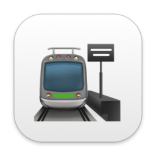

#  ÖBB Monitor

Terminal UI for live ÖBB (Austrian Federal Railways) departure and arrival data, streamed via WebSocket.

## Installation

### Homebrew

```bash
brew tap philroli/tap
brew install oebb-monitor
```

### Prebuilt binaries

Archives for macOS (arm64, x86_64) and Linux (x86_64) are attached to each
[GitHub release](https://github.com/philroli/oebb-monitor/releases). Their
build provenance can be verified with `gh attestation verify <archive> --repo philroli/oebb-monitor`.

### Build from source

Requires Rust 1.88+:

```bash
git clone https://github.com/philroli/oebb-monitor
cd oebb-monitor
cargo install --path .
```

## Usage

```bash
oebb-monitor                    # start at the last station used (first run: Wien Westbahnhof)
oebb-monitor --station "Linz"   # start at a station, by name or id (-s)
oebb-monitor --arrivals         # start with the arrivals board (-a)
oebb-monitor --version  # print version
oebb-monitor --help     # list options
oebb-monitor --debug    # write debug log to ~/.local/state/oebb-monitor/debug.log
```

### Keybindings

#### Main view

| Key | Action |
| --- | --- |
| `1`–`9`, `0` | Open detail for trains 1–10 |
| `↑` / `↓`, `j` / `k` | Move selection |
| `PgUp` / `PgDn` | Move selection by 10 trains |
| `Home` / `End`, `g` / `G` | First / last train |
| `Enter` | Open detail view |
| `/` | Filter trains by number, line, destination/origin or stop (`Enter` applies, `Esc` clears) |
| `Esc` | Clear the filter, then the selection |
| `A` | Switch to arrivals |
| `D` | Switch to departures |
| `S` | Search / change station |
| `R` | Reconnect and refresh |
| `L` | Toggle language (German / English) |
| `?` | Show all keys |
| `Q` | Quit |

#### Detail view

| Key | Action |
| --- | --- |
| `↑` / `↓`, `j` / `k` | Previous / next train |
| `Home` / `End`, `g` / `G` | First / last train |
| `PgUp` / `PgDn` | Scroll content |
| `L` | Toggle language (German / English) |
| `?` | Show all keys |
| `Esc` / `Q` | Close |

#### Station search

| Key | Action |
| --- | --- |
| Type | Filter by name (umlauts and spellings like `moedling`, `sankt` / `st.` all match) |
| `↑` / `↓` | Navigate results |
| `Enter` | Select station |
| `Esc` | Cancel |

## Features

- Live departures and arrivals for all 844 ÖBB stations
- Delay indicator with colour coding: on time (green), up to 5 min late (yellow), over 5 min late (red)
- Track changes highlighted in reverse video
- Station notices panel sized to its content, hidden when there are none
- Clock in the title bar and the age of the last update, turning yellow/red when the data goes stale
- Columns drop out on narrow terminals (sector first, then actual time, …) instead of being squashed
- Station search ranks main stations and name prefixes first; recent stations are listed when the search is empty
- Respects [`NO_COLOR`](https://no-color.org)
- Train detail view: intermediate stops, formation with wagon amenities (Wi-Fi, bicycle, wheelchair, bistro), operator, remarks
- German / English UI, toggled live with `L`; follows your locale until toggled
- Remembers the language (once toggled), last station, departures/arrivals choice and recent stations in `~/.config/oebb-monitor/config`
- Data stays live regardless of which mode is active (detail view, station search)
- Parallel loading across 5 WebSocket pages for full coverage
- Terminal cleaned up automatically on panic

Note: live feed text (station names, destinations, remarks, notices) is provided by ÖBB in German only and is shown as-is in both UI languages.

## Debugging

```bash
oebb-monitor --debug
# in a second terminal:
tail -f ~/.local/state/oebb-monitor/debug.log
```

The log captures WebSocket events, reconnect signals, item merges, and key input.

## Architecture

Single-binary Rust application, split into focused modules under `src/`:

| Module | Responsibility |
| --- | --- |
| `main.rs` | Terminal setup/teardown, input + redraw event loop |
| `app.rs` | Application state and pure helpers (with unit tests) |
| `model.rs` | Serde types for the WebSocket JSON payloads |
| `ws.rs` | Background task maintaining the live connection (with end-to-end tests against a local server) |
| `ui.rs` | All terminal rendering |
| `lang.rs` | German/English UI strings and the language toggle |
| `config.rs` | Persisted settings (language, station, board, recent stations) |
| `debug.rs` | Opt-in file logger and the `debug!` macro |

| Crate | Version | Purpose |
| --- | --- | --- |
| ratatui | 0.30 | TUI framework |
| crossterm | 0.29 | Terminal backend |
| tokio | 1 | Async runtime |
| tokio-tungstenite | 0.30 | WebSocket client (rustls, no OpenSSL needed) |
| serde / serde_json | 1 | JSON deserialisation |
| chrono | 0.4 | Time formatting |
| anyhow | 1 | Error handling |

Data source: `wss://meine.oebb.at/abfahrtankunft/webdisplay/web_client/ws/`

## Testing

```bash
cargo test                      # unit + local-server tests, no network needed
cargo test -- --ignored live    # also talk to the real ÖBB endpoint
```

CI runs the suite on Linux and macOS, plus an MSRV check. Merged Dependabot
PRs that touch `Cargo.toml`/`Cargo.lock` automatically release a new patch version.

## License

MIT
